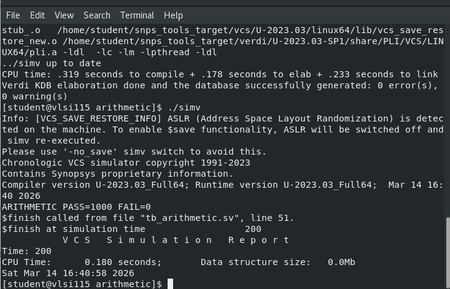
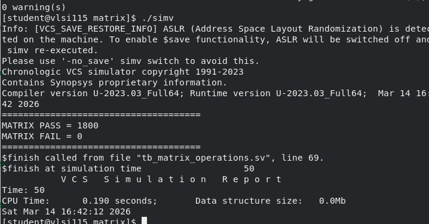
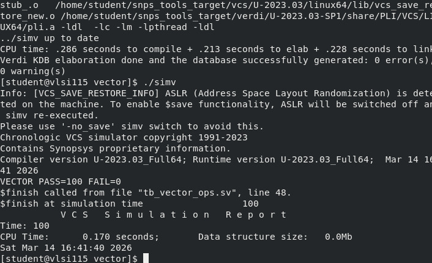
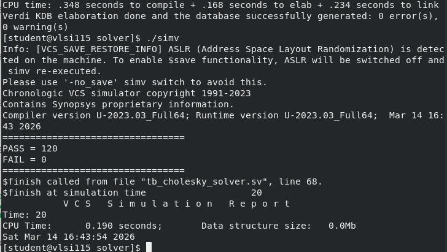
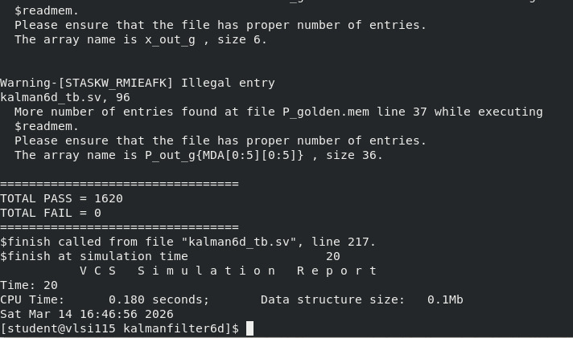
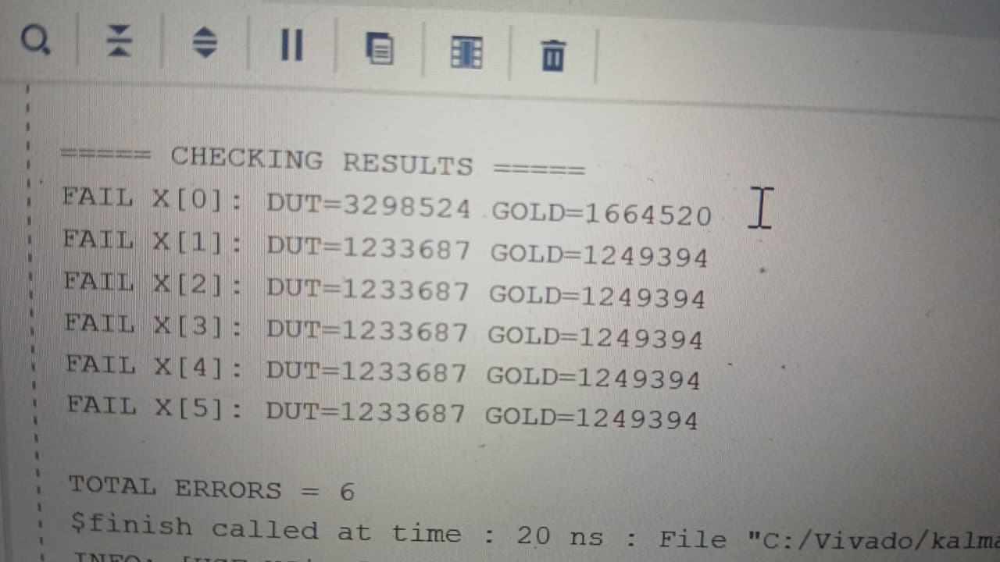
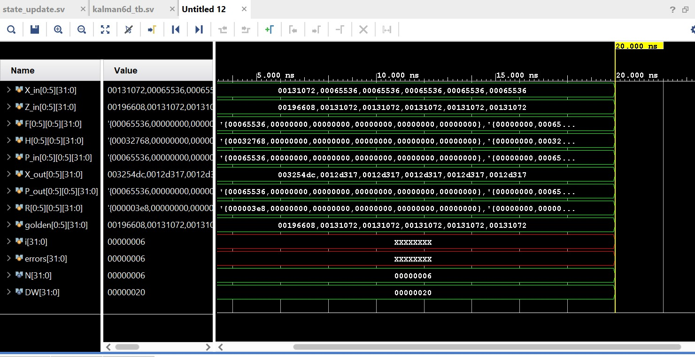

# REAL-TIME 6D KALMAN FILTER ACCELERATOR

<p align="center">
  <b>SystemVerilog RTL Design | Hardware Acceleration | Digital Design & Verification</b>
</p>

---

## Overview

This project focuses on the RTL design of a **Real-Time 6D Kalman Filter Accelerator** using SystemVerilog.

A Kalman Filter is a recursive estimation algorithm used to estimate the internal state of a dynamic system from noisy measurements. It is widely used in robotics, autonomous navigation, tracking systems, sensor fusion and motion estimation.

The objective of this project is to develop a modular hardware architecture capable of performing the fundamental mathematical operations involved in a six-dimensional Kalman Filter.

The design breaks down complex Kalman Filter computations into reusable hardware modules for arithmetic operations, matrix processing, vector calculations and matrix decomposition.

The project emphasizes:
- Modular RTL architecture.
- Hardware-oriented mathematical computation.
- Efficient arithmetic and matrix processing.
- SystemVerilog-based functional verification.
- Simulation and waveform analysis.

## Project Objectives

- Develop a hardware-oriented implementation of a 6D Kalman Filter.
- Design reusable RTL modules for arithmetic, matrix and vector operations.
- Implement matrix decomposition and solving operations required for Kalman Filter computations.
- Integrate individual computational blocks into a higher-level Kalman Filter architecture.
- Verify individual modules using SystemVerilog testbenches.
- Analyze simulation results and functional behavior using waveform visualization.

## Kalman Filter Fundamentals

A Kalman Filter estimates the state of a system through two major stages.

### 1. Prediction

Predicts the next system state and its uncertainty using the previous state and system model.

**State prediction:**

\[
\hat{x}_{k|k-1}=F\hat{x}_{k-1|k-1}
\]

**Covariance prediction:**

\[
P_{k|k-1}=FP_{k-1|k-1}F^T+Q
\]

### 2. Update / Correction

Corrects the predicted state using the latest measurement.

**Kalman Gain:**

\[
K_k=P_{k|k-1}H^T(HP_{k|k-1}H^T+R)^{-1}
\]

**State correction:**

\[
\hat{x}_{k|k}=\hat{x}_{k|k-1}+K_k(z_k-H\hat{x}_{k|k-1})
\]

**Covariance correction:**

\[
P_{k|k}=(I-K_kH)P_{k|k-1}
\]

Where:

| Parameter | Description |
|---|---|
| \(x\) | Estimated system state |
| \(F\) | State transition matrix |
| \(P\) | Error covariance matrix |
| \(Q\) | Process noise covariance |
| \(H\) | Observation matrix |
| \(R\) | Measurement noise covariance |
| \(K\) | Kalman Gain |
| \(z\) | Measurement vector |

## Hardware Architecture

The design is organized into independent computational blocks to improve modularity, reusability and verification.

### Major RTL Modules

| Module | Functionality |
|---|---|
| Arithmetic Unit | Performs fundamental arithmetic operations |
| Matrix Processing Unit | Handles matrix-related computations |
| Vector Processing Unit | Performs vector operations |
| Cholesky Solver | Implements Cholesky-based matrix decomposition and solving |
| Kalman Filter Core | Coordinates the computational blocks for Kalman Filter processing |

### Computational Flow

```text
       System Inputs / Measurements
                  |
                  v
          Vector Operations
                  |
                  v
          Matrix Operations
                  |
                  v
          Arithmetic Processing
                  |
                  v
         Matrix Decomposition
           (Cholesky Solver)
                  |
                  v
          Kalman Filter Core
                  |
                  v
           State Estimation
                  |
                  v
          Updated Covariance
```

*The diagram represents the major computational blocks; it is not intended as an exact RTL signal-level interconnection.*

## Repository Structure

```text
REAL-TIME-6D-KALMAN-FILTER-ACCELERATOR/
│
├── doc/
│   └── Project presentation and documentation
│
├── rtl/
│   ├── arithmetic/
│   │   └── Arithmetic RTL modules
│   │
│   ├── kalman/
│   │   └── Kalman Filter RTL modules
│   │
│   ├── matrix/
│   │   └── Matrix operation modules
│   │
│   ├── solver/
│   │   └── Cholesky solver modules
│   │
│   ├── vector/
│   │   └── Vector operation modules
│   │
│   └── kalman6d_core.sv
│
├── tb/
│   ├── kalman6d_tb.sv
│   ├── tb_arithmetic.sv
│   ├── tb_cholesky_solver.sv
│   ├── tb_matrix_operations.sv
│   ├── tb_vector_ops.sv
│   └── Input and reference memory files
│
├── run/
│   ├── filelist.f
│   ├── clean.sh
│   ├── kalmanfilter6d.sh
│   ├── run_arithmetic.sh
│   ├── run_matrix.sh
│   ├── run_solver.sh
│   ├── run_vector.sh
│   └── Simulation memory files
│
├── outputs/
│   ├── arithmetic_output.jpeg
│   ├── matrix_output.jpeg
│   ├── solver_output.jpeg
│   ├── vector_output.jpeg
│   ├── kalman_output.jpeg
│   ├── console_output.jpeg
│   └── output_verdi_waveform.jpeg
│
└── README.md
```

## Design and Implementation

### 1. Arithmetic Operations

Dedicated RTL modules are used to perform the fundamental arithmetic computations required by matrix and vector processing.

### 2. Matrix Operations

Matrix processing is a fundamental part of Kalman Filter computation. The matrix modules support the mathematical operations required by the estimation algorithm.

### 3. Vector Operations

Vector processing supports state and measurement-related computations.

### 4. Cholesky Solver

The solver implements Cholesky-based matrix decomposition and solving operations.

Cholesky decomposition expresses a suitable symmetric positive-definite matrix as:

\[
A=LL^T
\]

Where \(L\) is a lower triangular matrix.

This technique is useful for solving linear systems and can support efficient implementation of matrix-related calculations.

### 5. Kalman Filter Core

The top-level Kalman Filter core brings together the computational functionality to perform the intended 6D state estimation process.

## Verification and Simulation

The project includes dedicated SystemVerilog testbenches for individual computational blocks and the Kalman Filter design.

Verification is organized into separate test environments:

| Testbench | Verification Target |
|---|---|
| tb_arithmetic.sv | Arithmetic operations |
| tb_matrix_operations.sv | Matrix computations |
| tb_vector_ops.sv | Vector computations |
| tb_cholesky_solver.sv | Cholesky solver |
| kalman6d_tb.sv | Kalman Filter core |

### Verification Approach

- Apply input stimulus through SystemVerilog testbenches.
- Verify individual computational modules.
- Compare simulated results with reference data where applicable.
- Examine console output for functional results.
- Analyze signal transitions and timing using waveform visualization.
- Perform higher-level Kalman Filter simulation.

## Simulation Results

Simulation output files and waveform captures are maintained in the `outputs/` directory.

### Arithmetic Results



### Matrix Operations



### Vector Operations



### Cholesky Solver



### Kalman Filter Simulation



### Simulation Console



### Waveform Analysis



## Tools and Technologies

| Technology | Application |
|---|---|
| SystemVerilog | RTL design and testbench development |
| Synopsys VCS | RTL simulation |
| Synopsys Verdi | Waveform analysis and debugging |
| Linux / Shell Scripting | Simulation automation |
| Git and GitHub | Version control and project management |

## Running the Simulation

### Prerequisites

- Synopsys VCS simulator
- Synopsys Verdi (for waveform analysis)
- Linux environment
- SystemVerilog-compatible simulation environment

### Step 1: Clone the Repository

```bash
git clone https://github.com/Yashwanth20050906/REAL-TIME-6D-KALMAN-FILTER-ACCELERATOR.git
```

### Step 2: Navigate to the Project

```bash
cd REAL-TIME-6D-KALMAN-FILTER-ACCELERATOR
```

### Step 3: Run Individual Module Simulations

Run the respective shell scripts from the project root:

```bash
bash run/run_arithmetic.sh
bash run/run_matrix.sh
bash run/run_vector.sh
bash run/run_solver.sh
```

### Step 4: Run the Kalman Filter Simulation

```bash
bash run/kalmanfilter6d.sh
```

**Note:** The commands above use the simulation scripts provided in the repository. Refer to the scripts and `run/filelist.f` for the actual source-file and simulator configuration.

## Applications

Potential application areas include:

- Robotics and motion estimation.
- Autonomous navigation.
- Sensor fusion.
- Object tracking.
- Inertial measurement systems.
- Embedded estimation systems.
- Real-time state estimation.

## Key Learning Outcomes

This project provides practical experience in:

- SystemVerilog RTL development.
- Modular hardware architecture.
- Arithmetic datapath design.
- Matrix and vector computation in hardware.
- Matrix decomposition algorithms.
- Hardware-oriented algorithm implementation.
- Testbench development and functional verification.
- Simulation debugging and waveform analysis.
- Synopsys VCS and Verdi workflows.

## Future Enhancements

- Optimize arithmetic datapaths for reduced latency.
- Explore pipelining and parallel processing.
- Improve fixed-point numerical precision and resource utilization.
- Develop more comprehensive automated verification.
- Explore FPGA prototyping and hardware implementation.
- Evaluate throughput, latency and hardware resource utilization.

## Author

**Yashwanth Chakravarthy**

Electronics and Communication Engineering

**Areas of Interest:**
- RTL Design and Verification
- VLSI Design
- Digital Hardware Architecture
- SystemVerilog
- Hardware Acceleration

---

## License

This project is intended for academic and educational purposes. Add an appropriate open-source license before permitting reuse or redistribution.

---

**REAL-TIME 6D KALMAN FILTER ACCELERATOR**

*Exploring hardware acceleration of state estimation through modular RTL design.*
